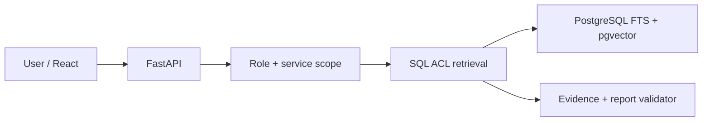
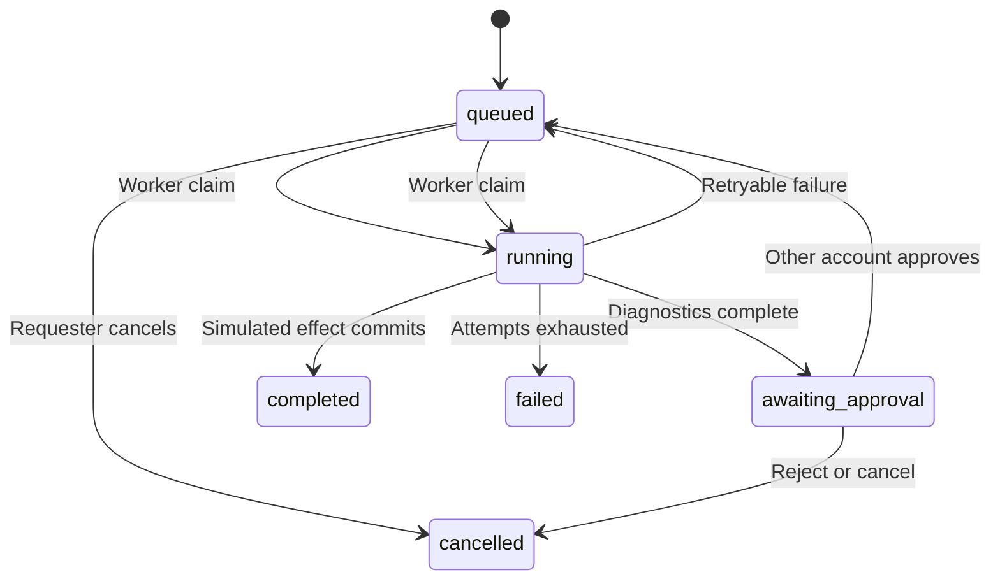

# Architecture at a glance

## Request and evidence flow

The client never talks directly to PostgreSQL. Candidate retrieval and final source fetch enforce document grants and service membership in SQL. The investigation collector draws from alerts, metrics, logs, deployment markers, dependencies and authorized runbook passages. The provider returns structured claims; validation rejects unknown citation IDs and unsafe recommended actions. A valid ID is only structural support; a person must read the passage to judge a claim.

## Approval and retry

The `workflows` table is the durable queue. `FOR UPDATE SKIP LOCKED` leases one job. The worker rechecks requester scope, current approver rights, the exact plan hash and the one allowed action before writing a simulated outcome. The effect has a unique key and commits with the state change. At-least-once delivery is expected; no exactly-once or real-world remediation claim is made.

## Local observability and deployment

`compose.yaml` provides PostgreSQL by default. `--profile full` adds migration, API, worker, nginx frontend and Jaeger; `--profile observability` adds Prometheus and Grafana. The API exposes bounded route metrics at `/metrics`, and the worker exposes queue/step metrics on its internal port. API request IDs and optional OpenTelemetry trace IDs help correlate safe logs. This demo has no production retention, alerts or HA. See `docs/architecture.md` for the original design decisions and differences between planned and implemented scope.

## Stage 10 observed local target

A separate Python HTTP server answers checkout requests. A traffic process continuously calls it, while a collector polls its bounded in-memory event buffer. The collector stores aggregate request/error counts, observed p95 duration, failure logs and alert evaluation in PostgreSQL; it commits the cursor with those rows. The older synthetic fixture remains separate. A local nginx route exposes only `/checkout-demo/checkout` for demonstration, while admin-only failure control uses an internal Compose address. See `docs/live-demo.md`.
