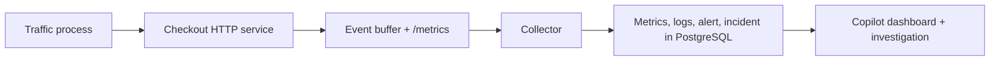

# Stage 10: observed local checkout service

This adds a **separate running HTTP service**, rather than generating checkout metrics directly from a fixed fixture. A traffic process sends checkout requests roughly every 350 ms. The service normally returns HTTP 200; an admin can toggle a controlled connection-pool failure to return HTTP 503. Each handled request contributes an event with a timestamp, status and measured duration. A collector polls a bounded event buffer, aggregates new requests into PostgreSQL metric samples, stores failed-request logs, evaluates the error-rate rule and commits its cursor with the alert. The Dashboard, Incidents, Knowledge, Investigations and Workflows then consume the same stored data as before.



The service is a **local teaching target**, not a production checkout or a production telemetry integration. It has no payments, customers, durable request log, backpressure strategy or external secrets. The older Stage 2 fixed synthetic fixture remains as a separate option and is labelled accordingly.

## Run on your existing Stage 9 Docker data

1. In the Stage 9 folder, take a backup with `bash scripts/backup.sh` while `db` is running.
2. Extract the Stage 10 ZIP **over that same project folder**, retaining `backend/.env` and the Compose project name. Extracting into a differently named folder creates a separate Compose project and volume unless you specify the old name with `-p`.
3. From the folder with `compose.yaml`, run:

```bash
docker compose --profile full --profile observability up -d --build
docker compose --profile full --profile observability ps
docker compose --profile full exec -T api alembic current
```

The migration revision should be `0006_live_demo_cursor`. Check `checkout-demo` is healthy and `checkout-traffic` and `checkout-collector` are running. The collector creates a `live-checkout-demo` service and rule, then grants the seeded local users membership on its next poll. The control API is admin-only; the checkout service's control/event endpoints are internal to Compose.

## Manual demo

1. Open <http://localhost:8080/checkout-demo/checkout> to see a real HTTP 200 response from the target through the frontend proxy. This path exposes **only checkout requests**, not internal failure control.
2. Sign in to <http://localhost:8080> as `admin@local.example`. On Overview, find **Live checkout service**. Click **Load live runbook**; this uses your configured embedding mode, so on a fresh setup `EMBEDDING_MODE=mock` avoids a model download.
3. Select the `live-checkout-demo` service card. You should see recent observed local HTTP batches with low errors. Click **Trigger checkout failure**. The checkout URL now returns HTTP 503, and the ongoing traffic continues without a new command.
4. Wait about 10 seconds and click **Refresh**. The observed batch should show failed requests and error logs. Open **Incidents** and find the **Live checkout error rate** alert and incident. It will remain open until a responder resolves it.
5. As a responder, generate an investigation of that live incident. Inspect the citation to the live runbook. A diagnosis remains a hypothesis: this target deliberately emits a pool-exhaustion message, but no real database pool is measured.
6. As an admin, click **Restore checkout**. Subsequent traffic returns HTTP 200; refresh after another 10 seconds to show recovery. The old incident remains a historical record until manually resolved.

The optional `app.review.live_run` command tests this journey through the API and clears failure mode in a `finally` block. It records sample/incident IDs and counts, without dumping passwords or document text:

```bash
cd backend
py -3.12 -m uv sync --frozen --extra dev
py -3.12 -m uv run --frozen python -m app.review.live_run --base-url http://127.0.0.1:8080 --output ../review-live-stage10.json
```

Use a new output filename on repeat. This script requires `INVESTIGATION_PROVIDER=mock` in the running API and your local `.env` to prevent paid calls. Repeated investigations may reach the existing per-user hourly limit. If it fails, check `docker compose --profile full logs --tail=80 checkout-demo checkout-traffic checkout-collector api` from the project root, without sharing secrets.

## Limits and verification

The target's in-memory ring holds 1,000 recent events. A delayed collector marks a sequence gap in `log_events` when entries were dropped; the resulting aggregate is incomplete. The cursor stores service instance ID and last processed sequence and advances in the same transaction as samples and alerts. The real HTTP server test passes here; the PostgreSQL collector integration and complete Compose chain are opt-in and cannot be claimed passed until run on Docker. Prometheus also scrapes `checkout-demo:8081/metrics`; those counters are distinct from the copilot's stored metric samples.
